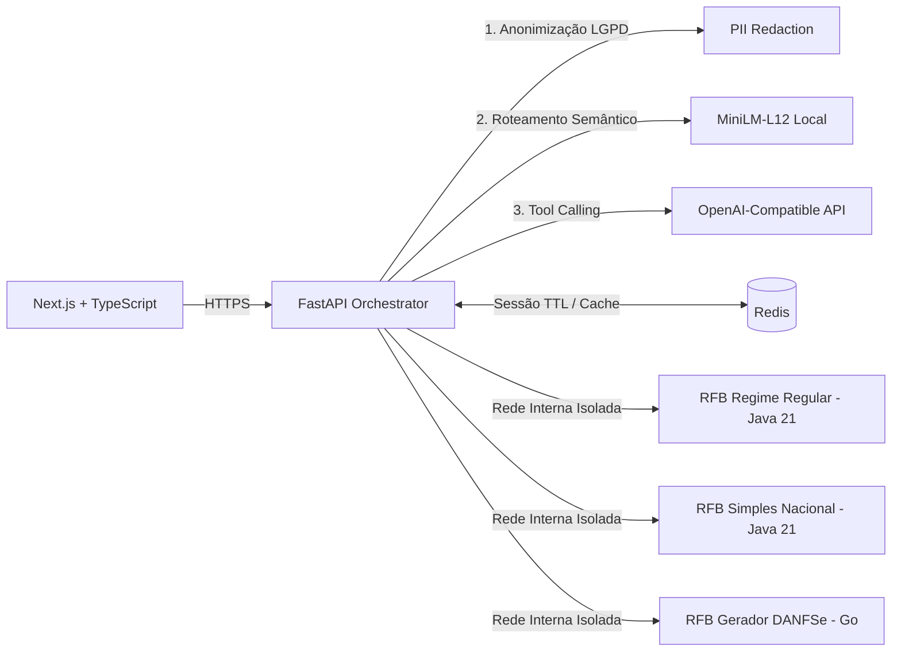

# Agente de Simulação Tributária — RTC

> **Aviso Legal:** Este é um projeto independente de estudo e engenharia de software, sem vínculo oficial com a Receita Federal do Brasil (RFB) ou órgãos governamentais. Os resultados gerados têm caráter exclusivamente **simulatório e educacional**, baseados nos motores open-source publicados sob a Portaria Cotec nº 342/2026 (Licença MIT), não substituindo escrituração fiscal oficial ou parecer contábil.

Agente conversacional determinístico para simulação da Reforma Tributária do Consumo (**CBS**, **IBS** e **Imposto Seletivo** — LC 214/2025). Em vez de deixar um LLM calcular tributos de forma probabilística, a IA atua apenas como camada de compreensão de linguagem natural (NLU) e orquestração (*Tool Calling*), delegando toda a matemática fiscal e a geração de documentos aos contêineres oficiais da Receita Federal.

---

## Arquitetura



## Pilares Técnicos

- **Zero Alucinação Tributária:** O modelo de linguagem extrai os parâmetros da operação via Structured Outputs e aciona os motores oficiais da RFB em rede interna isolada (`fiscal_internal`).
- **Privacidade by Design (LGPD):** Middleware de sanitização mascara CPFs, CNPJs e e-mails antes de qualquer chamada externa ao LLM, combinado com sessões efêmeras com expiração automática (TTL) no Redis.
- **Roteamento Semântico Local:** Uso de embeddings leves (`paraphrase-multilingual-MiniLM-L12-v2`) para atuar como gatekeeper de escopo e mapear descrições em linguagem natural (ex.: "venda de curso online gravado") aos códigos técnicos (`cClassTrib` / NBS).

## Motores Conteinerizados (RFB)

| Serviço Interno | Stack | Responsabilidade |
|---|---|---|
| `rfb-regime-regular` | Java 21 + Spring Boot + SQLite | Apuração de CBS, IBS e IS (Lucro Real/Presumido), consulta de NBS/alíquotas e geração/validação de XML fiscal. |
| `rfb-simples-nacional` | Java 21 + Spring Boot + SQLite | Apuração de CBS e IBS e consulta de anexos/atividades vigentes para optantes do Simples Nacional. |
| `rfb-gerador-danfse` | Go | Renderização do documento auxiliar DANFSe em PDF a partir do XML da NFS-e. |

## Stack do Projeto

- **Backend & Orquestração:** Python 3.12+, FastAPI, Pydantic v2, httpx, OpenAI SDK, fastembed
- **Cache & Estado Efêmero:** Redis 7
- **Frontend:** Next.js (App Router), TypeScript, Tailwind CSS
- **Infraestrutura & Qualidade:** Docker Compose, Ruff, Pytest

## Como Executar Localmente

1. Clone os repositórios oficiais da Receita Federal para dentro de `services/` (diretório ignorado pelo Git):

   ```bash
   ./scripts/setup_rfb.sh
   ```

2. Configure as variáveis de ambiente:

   ```bash
   cp .env.example .env
   ```

3. Suba os contêineres (o build Java executa automaticamente as migrações Flyway para gerar o banco SQLite offline):

   ```bash
   docker compose -f infra/docker-compose.yml up -d --build
   ```

## Status do Desenvolvimento

- [x] Estrutura do monorepo, documentação e scripts de setup dos motores da RFB
- [x] Conteinerização isolada (`rfb-regime-regular`, `rfb-simples-nacional`, `rfb-gerador-danfse` e Redis)
- [ ] Core do backend FastAPI, filtro LGPD e cliente assíncrono dos motores fiscais
- [ ] Orquestrador de IA (Tool Calling + roteamento semântico + cache Redis)
- [ ] Interface web em Next.js + TypeScript
